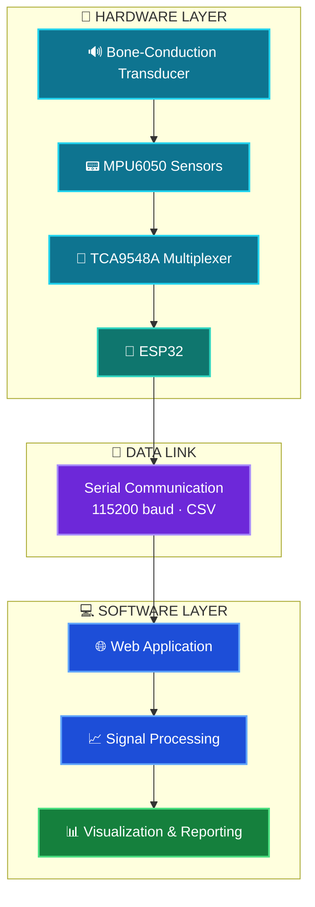

<svg xmlns="http://www.w3.org/2000/svg" viewBox="0 0 1200 330" width="1200" height="330" xmlns:c2pa="http://c2pa.org/manifest">
<defs>
<linearGradient id="bg" x1="0" y1="0" x2="1" y2="1"><stop offset="0" stop-color="#050B18"/><stop offset=".55" stop-color="#0B1B33"/><stop offset="1" stop-color="#0A1F2E"/></linearGradient>
<linearGradient id="ttl" x1="0" x2="1"><stop offset="0" stop-color="#22D3EE"/><stop offset=".5" stop-color="#8B5CF6"/><stop offset="1" stop-color="#22C55E"/></linearGradient>
<pattern id="grid" width="40" height="40" patternUnits="userSpaceOnUse"><path d="M40 0H0V40" fill="none" stroke="#1E3A5F" stroke-width=".6" opacity=".45"/></pattern>
<filter id="glow"><feGaussianBlur stdDeviation="3" result="b"/><feMerge><feMergeNode in="b"/><feMergeNode in="SourceGraphic"/></feMerge></filter>
</defs>
<rect width="1200" height="330" rx="18" fill="url(#bg)"/>
<rect width="1200" height="330" rx="18" fill="url(#grid)"/>
<g fill="none" stroke-linecap="round" filter="url(#glow)">
<path d="M0.0,215.0 L5.0,220.8 L10.0,226.5 L15.0,231.8 L20.0,236.5 L25.0,240.6 L30.0,243.9 L35.0,246.3 L40.0,247.9 L45.0,248.7 L50.0,248.7 L55.0,248.0 L60.0,246.7 L65.0,245.1 L70.0,243.2 L75.0,241.2 L80.0,239.3 L85.0,237.7 L90.0,236.5 L95.0,235.7 L100.0,235.4 L105.0,235.7 L110.0,236.5 L115.0,237.7 L120.0,239.3 L125.0,241.2 L130.0,243.2 L135.0,245.1 L140.0,246.7 L145.0,248.0 L150.0,248.7 L155.0,248.7 L160.0,247.9 L165.0,246.3 L170.0,243.9 L175.0,240.6 L180.0,236.5 L185.0,231.8 L190.0,226.5 L195.0,220.8 L200.0,215.0 L205.0,209.2 L210.0,203.5 L215.0,198.2 L220.0,193.5 L225.0,189.4 L230.0,186.1 L235.0,183.7 L240.0,182.1 L245.0,181.3 L250.0,181.3 L255.0,182.0 L260.0,183.3 L265.0,184.9 L270.0,186.8 L275.0,188.8 L280.0,190.7 L285.0,192.3 L290.0,193.5 L295.0,194.3 L300.0,194.6 L305.0,194.3 L310.0,193.5 L315.0,192.3 L320.0,190.7 L325.0,188.8 L330.0,186.8 L335.0,184.9 L340.0,183.3 L345.0,182.0 L350.0,181.3 L355.0,181.3 L360.0,182.1 L365.0,183.7 L370.0,186.1 L375.0,189.4 L380.0,193.5 L385.0,198.2 L390.0,203.5 L395.0,209.2 L400.0,215.0 L405.0,220.8 L410.0,226.5 L415.0,231.8 L420.0,236.5 L425.0,240.6 L430.0,243.9 L435.0,246.3 L440.0,247.9 L445.0,248.7 L450.0,248.7 L455.0,248.0 L460.0,246.7 L465.0,245.1 L470.0,243.2 L475.0,241.2 L480.0,239.3 L485.0,237.7 L490.0,236.5 L495.0,235.7 L500.0,235.4 L505.0,235.7 L510.0,236.5 L515.0,237.7 L520.0,239.3 L525.0,241.2 L530.0,243.2 L535.0,245.1 L540.0,246.7 L545.0,248.0 L550.0,248.7 L555.0,248.7 L560.0,247.9 L565.0,246.3 L570.0,243.9 L575.0,240.6 L580.0,236.5 L585.0,231.8 L590.0,226.5 L595.0,220.8 L600.0,215.0 L605.0,209.2 L610.0,203.5 L615.0,198.2 L620.0,193.5 L625.0,189.4 L630.0,186.1 L635.0,183.7 L640.0,182.1 L645.0,181.3 L650.0,181.3 L655.0,182.0 L660.0,183.3 L665.0,184.9 L670.0,186.8 L675.0,188.8 L680.0,190.7 L685.0,192.3 L690.0,193.5 L695.0,194.3 L700.0,194.6 L705.0,194.3 L710.0,193.5 L715.0,192.3 L720.0,190.7 L725.0,188.8 L730.0,186.8 L735.0,184.9 L740.0,183.3 L745.0,182.0 L750.0,181.3 L755.0,181.3 L760.0,182.1 L765.0,183.7 L770.0,186.1 L775.0,189.4 L780.0,193.5 L785.0,198.2 L790.0,203.5 L795.0,209.2 L800.0,215.0 L805.0,220.8 L810.0,226.5 L815.0,231.8 L820.0,236.5 L825.0,240.6 L830.0,243.9 L835.0,246.3 L840.0,247.9 L845.0,248.7 L850.0,248.7 L855.0,248.0 L860.0,246.7 L865.0,245.1 L870.0,243.2 L875.0,241.2 L880.0,239.3 L885.0,237.7 L890.0,236.5 L895.0,235.7 L900.0,235.4 L905.0,235.7 L910.0,236.5 L915.0,237.7 L920.0,239.3 L925.0,241.2 L930.0,243.2 L935.0,245.1 L940.0,246.7 L945.0,248.0 L950.0,248.7 L955.0,248.7 L960.0,247.9 L965.0,246.3 L970.0,243.9 L975.0,240.6 L980.0,236.5 L985.0,231.8 L990.0,226.5 L995.0,220.8 L1000.0,215.0 L1005.0,209.2 L1010.0,203.5 L1015.0,198.2 L1020.0,193.5 L1025.0,189.4 L1030.0,186.1 L1035.0,183.7 L1040.0,182.1 L1045.0,181.3 L1050.0,181.3 L1055.0,182.0 L1060.0,183.3 L1065.0,184.9 L1070.0,186.8 L1075.0,188.8 L1080.0,190.7 L1085.0,192.3 L1090.0,193.5 L1095.0,194.3 L1100.0,194.6 L1105.0,194.3 L1110.0,193.5 L1115.0,192.3 L1120.0,190.7 L1125.0,188.8 L1130.0,186.8 L1135.0,184.9 L1140.0,183.3 L1145.0,182.0 L1150.0,181.3 L1155.0,181.3 L1160.0,182.1 L1165.0,183.7 L1170.0,186.1 L1175.0,189.4 L1180.0,193.5 L1185.0,198.2 L1190.0,203.5 L1195.0,209.2 L1200.0,215.0" stroke="#22D3EE" stroke-width="2.2" opacity=".9" stroke-dasharray="1400" stroke-dashoffset="1400"><animate attributeName="stroke-dashoffset" from="1400" to="0" dur="3s" fill="freeze"/></path>
<path d="M0.0,254.1 L5.0,255.4 L10.0,256.1 L15.0,256.2 L20.0,255.8 L25.0,254.9 L30.0,253.4 L35.0,251.6 L40.0,249.3 L45.0,246.7 L50.0,243.9 L55.0,241.0 L60.0,238.0 L65.0,235.1 L70.0,232.2 L75.0,229.5 L80.0,227.2 L85.0,225.1 L90.0,223.3 L95.0,222.0 L100.0,221.0 L105.0,220.5 L110.0,220.3 L115.0,220.5 L120.0,221.0 L125.0,221.7 L130.0,222.6 L135.0,223.7 L140.0,224.7 L145.0,225.7 L150.0,226.6 L155.0,227.2 L160.0,227.6 L165.0,227.6 L170.0,227.3 L175.0,226.5 L180.0,225.3 L185.0,223.6 L190.0,221.5 L195.0,218.9 L200.0,216.0 L205.0,212.7 L210.0,209.2 L215.0,205.5 L220.0,201.6 L225.0,197.7 L230.0,193.9 L235.0,190.3 L240.0,186.9 L245.0,183.8 L250.0,181.1 L255.0,178.9 L260.0,177.2 L265.0,176.0 L270.0,175.3 L275.0,175.2 L280.0,175.6 L285.0,176.6 L290.0,178.0 L295.0,179.8 L300.0,182.0 L305.0,184.4 L310.0,187.0 L315.0,189.7 L320.0,192.4 L325.0,195.0 L330.0,197.5 L335.0,199.7 L340.0,201.7 L345.0,203.3 L350.0,204.6 L355.0,205.5 L360.0,206.0 L365.0,206.1 L370.0,205.9 L375.0,205.3 L380.0,204.5 L385.0,203.5 L390.0,202.4 L395.0,201.2 L400.0,200.1 L405.0,199.0 L410.0,198.2 L415.0,197.6 L420.0,197.4 L425.0,197.5 L430.0,198.1 L435.0,199.1 L440.0,200.6 L445.0,202.6 L450.0,205.0 L455.0,207.8 L460.0,211.0 L465.0,214.6 L470.0,218.3 L475.0,222.3 L480.0,226.3 L485.0,230.3 L490.0,234.2 L495.0,237.9 L500.0,241.3 L505.0,244.4 L510.0,247.0 L515.0,249.2 L520.0,250.9 L525.0,252.0 L530.0,252.6 L535.0,252.6 L540.0,252.2 L545.0,251.2 L550.0,249.9 L555.0,248.1 L560.0,246.1 L565.0,243.9 L570.0,241.5 L575.0,239.1 L580.0,236.7 L585.0,234.4 L590.0,232.4 L595.0,230.5 L600.0,229.0 L605.0,227.9 L610.0,227.1 L615.0,226.7 L620.0,226.6 L625.0,227.0 L630.0,227.6 L635.0,228.5 L640.0,229.7 L645.0,231.0 L650.0,232.3 L655.0,233.6 L660.0,234.9 L665.0,236.0 L670.0,236.8 L675.0,237.3 L680.0,237.4 L685.0,237.1 L690.0,236.3 L695.0,235.1 L700.0,233.3 L705.0,231.1 L710.0,228.4 L715.0,225.4 L720.0,221.9 L725.0,218.2 L730.0,214.3 L735.0,210.2 L740.0,206.1 L745.0,202.0 L750.0,198.1 L755.0,194.4 L760.0,191.0 L765.0,188.0 L770.0,185.4 L775.0,183.3 L780.0,181.7 L785.0,180.7 L790.0,180.2 L795.0,180.2 L800.0,180.7 L805.0,181.6 L810.0,182.9 L815.0,184.6 L820.0,186.4 L825.0,188.5 L830.0,190.6 L835.0,192.7 L840.0,194.8 L845.0,196.6 L850.0,198.3 L855.0,199.7 L860.0,200.7 L865.0,201.3 L870.0,201.6 L875.0,201.6 L880.0,201.1 L885.0,200.3 L890.0,199.3 L895.0,198.0 L900.0,196.5 L905.0,195.0 L910.0,193.4 L915.0,191.9 L920.0,190.6 L925.0,189.5 L930.0,188.7 L935.0,188.2 L940.0,188.2 L945.0,188.6 L950.0,189.6 L955.0,191.0 L960.0,193.0 L965.0,195.4 L970.0,198.3 L975.0,201.5 L980.0,205.2 L985.0,209.0 L990.0,213.1 L995.0,217.2 L1000.0,221.4 L1005.0,225.5 L1010.0,229.4 L1015.0,233.0 L1020.0,236.3 L1025.0,239.2 L1030.0,241.7 L1035.0,243.6 L1040.0,245.1 L1045.0,246.0 L1050.0,246.5 L1055.0,246.4 L1060.0,245.9 L1065.0,244.9 L1070.0,243.7 L1075.0,242.1 L1080.0,240.4 L1085.0,238.6 L1090.0,236.7 L1095.0,234.9 L1100.0,233.3 L1105.0,231.8 L1110.0,230.6 L1115.0,229.7 L1120.0,229.2 L1125.0,229.0 L1130.0,229.2 L1135.0,229.8 L1140.0,230.7 L1145.0,231.9 L1150.0,233.4 L1155.0,235.0 L1160.0,236.8 L1165.0,238.6 L1170.0,240.4 L1175.0,242.1 L1180.0,243.5 L1185.0,244.7 L1190.0,245.5 L1195.0,245.8 L1200.0,245.8" stroke="#8B5CF6" stroke-width="2" opacity=".8" stroke-dasharray="1400" stroke-dashoffset="1400"><animate attributeName="stroke-dashoffset" from="1400" to="0" dur="3.6s" fill="freeze"/></path>
<path d="M0.0,235.1 L5.0,230.9 L10.0,226.1 L15.0,221.2 L20.0,216.4 L25.0,212.0 L30.0,208.3 L35.0,205.5 L40.0,203.5 L45.0,202.5 L50.0,202.1 L55.0,202.3 L60.0,202.8 L65.0,203.3 L70.0,203.6 L75.0,203.4 L80.0,202.7 L85.0,201.3 L90.0,199.4 L95.0,197.1 L100.0,194.7 L105.0,192.3 L110.0,190.4 L115.0,189.2 L120.0,188.8 L125.0,189.6 L130.0,191.5 L135.0,194.4 L140.0,198.3 L145.0,202.9 L150.0,207.8 L155.0,212.8 L160.0,217.6 L165.0,221.8 L170.0,225.3 L175.0,227.8 L180.0,229.4 L185.0,230.1 L190.0,230.1 L195.0,229.6 L200.0,228.9 L205.0,228.2 L210.0,227.8 L215.0,227.9 L220.0,228.5 L225.0,229.8 L230.0,231.5 L235.0,233.5 L240.0,235.7 L245.0,237.6 L250.0,239.1 L255.0,239.8 L260.0,239.5 L265.0,238.2 L270.0,235.8 L275.0,232.3 L280.0,228.0 L285.0,223.2 L290.0,218.1 L295.0,213.0 L300.0,208.4 L305.0,204.4 L310.0,201.2 L315.0,199.1 L320.0,197.9 L325.0,197.6 L330.0,197.9 L335.0,198.7 L340.0,199.7 L345.0,200.6 L350.0,201.2 L355.0,201.2 L360.0,200.7 L365.0,199.6 L370.0,198.1 L375.0,196.3 L380.0,194.5 L385.0,192.9 L390.0,192.0 L395.0,191.8 L400.0,192.6 L405.0,194.5 L410.0,197.4 L415.0,201.3 L420.0,205.9 L425.0,211.0 L430.0,216.2 L435.0,221.1 L440.0,225.6 L445.0,229.3 L450.0,232.0 L455.0,233.7 L460.0,234.5 L465.0,234.4 L470.0,233.6 L475.0,232.5 L480.0,231.2 L485.0,230.1 L490.0,229.4 L495.0,229.2 L500.0,229.6 L505.0,230.6 L510.0,231.9 L515.0,233.4 L520.0,234.9 L525.0,236.0 L530.0,236.5 L535.0,236.1 L540.0,234.8 L545.0,232.4 L550.0,229.0 L555.0,224.8 L560.0,219.9 L565.0,214.8 L570.0,209.6 L575.0,204.8 L580.0,200.7 L585.0,197.4 L590.0,195.1 L595.0,193.8 L600.0,193.6 L605.0,194.1 L610.0,195.3 L615.0,196.8 L620.0,198.3 L625.0,199.6 L630.0,200.4 L635.0,200.8 L640.0,200.5 L645.0,199.7 L650.0,198.6 L655.0,197.4 L660.0,196.2 L665.0,195.5 L670.0,195.5 L675.0,196.4 L680.0,198.2 L685.0,201.0 L690.0,204.8 L695.0,209.3 L700.0,214.3 L705.0,219.5 L710.0,224.5 L715.0,229.1 L720.0,232.8 L725.0,235.7 L730.0,237.5 L735.0,238.2 L740.0,237.9 L745.0,236.9 L750.0,235.3 L755.0,233.5 L760.0,231.8 L765.0,230.3 L770.0,229.2 L775.0,228.8 L780.0,228.9 L785.0,229.5 L790.0,230.4 L795.0,231.4 L800.0,232.2 L805.0,232.5 L810.0,232.1 L815.0,230.8 L820.0,228.5 L825.0,225.3 L830.0,221.3 L835.0,216.5 L840.0,211.5 L845.0,206.4 L850.0,201.6 L855.0,197.4 L860.0,194.0 L865.0,191.7 L870.0,190.4 L875.0,190.3 L880.0,191.1 L885.0,192.6 L890.0,194.5 L895.0,196.7 L900.0,198.7 L905.0,200.4 L910.0,201.5 L915.0,202.1 L920.0,202.1 L925.0,201.7 L930.0,201.0 L935.0,200.2 L940.0,199.8 L945.0,199.8 L950.0,200.6 L955.0,202.3 L960.0,205.0 L965.0,208.5 L970.0,212.8 L975.0,217.6 L980.0,222.6 L985.0,227.6 L990.0,232.1 L995.0,235.9 L1000.0,238.7 L1005.0,240.5 L1010.0,241.1 L1015.0,240.7 L1020.0,239.4 L1025.0,237.4 L1030.0,235.1 L1035.0,232.6 L1040.0,230.4 L1045.0,228.5 L1050.0,227.2 L1055.0,226.6 L1060.0,226.4 L1065.0,226.8 L1070.0,227.3 L1075.0,227.7 L1080.0,227.9 L1085.0,227.5 L1090.0,226.4 L1095.0,224.3 L1100.0,221.4 L1105.0,217.6 L1110.0,213.2 L1115.0,208.4 L1120.0,203.4 L1125.0,198.7 L1130.0,194.6 L1135.0,191.3 L1140.0,189.0 L1145.0,187.9 L1150.0,187.8 L1155.0,188.8 L1160.0,190.7 L1165.0,193.1 L1170.0,195.9 L1175.0,198.6 L1180.0,201.0 L1185.0,203.0 L1190.0,204.4 L1195.0,205.1 L1200.0,205.3" stroke="#22C55E" stroke-width="1.8" opacity=".75" stroke-dasharray="1400" stroke-dashoffset="1400"><animate attributeName="stroke-dashoffset" from="1400" to="0" dur="4.2s" fill="freeze"/></path>
</g>
<text x="600" y="110" text-anchor="middle" font-family="Segoe UI, Helvetica, Arial, sans-serif" font-size="74" font-weight="800" letter-spacing="2" fill="url(#ttl)">NeuroSense-X</text>
<text x="600" y="150" text-anchor="middle" font-family="Segoe UI, Helvetica, Arial, sans-serif" font-size="20" letter-spacing="5" fill="#94A3B8">AI-ASSISTED CRANIAL MECHANICAL VIBRATION ANALYSIS</text>
<g transform="translate(0,150)"><rect x="840" y="109.2" width="12" height="10.799999999999999" rx="3" fill="#22D3EE" opacity=".85"><animate attributeName="height" values="10.799999999999999;5.9399999999999995;10.799999999999999" dur="2.0s" repeatCount="indefinite"/><animate attributeName="y" values="109.2;114.06;109.2" dur="2.0s" repeatCount="indefinite"/></rect><rect x="860" y="102.0" width="12" height="18.0" rx="3" fill="#22D3EE" opacity=".85"><animate attributeName="height" values="18.0;9.9;18.0" dur="2.4s" repeatCount="indefinite"/><animate attributeName="y" values="102.0;110.1;102.0" dur="2.4s" repeatCount="indefinite"/></rect><rect x="880" y="88.8" width="12" height="31.2" rx="3" fill="#22D3EE" opacity=".85"><animate attributeName="height" values="31.2;17.16;31.2" dur="2.8s" repeatCount="indefinite"/><animate attributeName="y" values="88.8;102.84;88.8" dur="2.8s" repeatCount="indefinite"/></rect><rect x="900" y="67.2" width="12" height="52.8" rx="3" fill="#8B5CF6" opacity=".85"><animate attributeName="height" values="52.8;29.04;52.8" dur="3.2s" repeatCount="indefinite"/><animate attributeName="y" values="67.2;90.96000000000001;67.2" dur="3.2s" repeatCount="indefinite"/></rect><rect x="920" y="81.6" width="12" height="38.4" rx="3" fill="#8B5CF6" opacity=".85"><animate attributeName="height" values="38.4;21.12;38.4" dur="3.6s" repeatCount="indefinite"/><animate attributeName="y" values="81.6;98.88;81.6" dur="3.6s" repeatCount="indefinite"/></rect><rect x="940" y="96.0" width="12" height="24.0" rx="3" fill="#22D3EE" opacity=".85"><animate attributeName="height" values="24.0;13.200000000000001;24.0" dur="2.0s" repeatCount="indefinite"/><animate attributeName="y" values="96.0;106.8;96.0" dur="2.0s" repeatCount="indefinite"/></rect><rect x="960" y="104.4" width="12" height="15.6" rx="3" fill="#22D3EE" opacity=".85"><animate attributeName="height" values="15.6;8.58;15.6" dur="2.4s" repeatCount="indefinite"/><animate attributeName="y" values="104.4;111.42;104.4" dur="2.4s" repeatCount="indefinite"/></rect><rect x="980" y="78.0" width="12" height="42.0" rx="3" fill="#8B5CF6" opacity=".85"><animate attributeName="height" values="42.0;23.1;42.0" dur="2.8s" repeatCount="indefinite"/><animate attributeName="y" values="78.0;96.9;78.0" dur="2.8s" repeatCount="indefinite"/></rect><rect x="1000" y="54.0" width="12" height="66.0" rx="3" fill="#22C55E" opacity=".85"><animate attributeName="height" values="66.0;36.300000000000004;66.0" dur="3.2s" repeatCount="indefinite"/><animate attributeName="y" values="54.0;83.69999999999999;54.0" dur="3.2s" repeatCount="indefinite"/></rect><rect x="1020" y="74.4" width="12" height="45.6" rx="3" fill="#8B5CF6" opacity=".85"><animate attributeName="height" values="45.6;25.080000000000002;45.6" dur="3.6s" repeatCount="indefinite"/><animate attributeName="y" values="74.4;94.92;74.4" dur="3.6s" repeatCount="indefinite"/></rect><rect x="1040" y="93.6" width="12" height="26.4" rx="3" fill="#22D3EE" opacity=".85"><animate attributeName="height" values="26.4;14.52;26.4" dur="2.0s" repeatCount="indefinite"/><animate attributeName="y" values="93.6;105.48;93.6" dur="2.0s" repeatCount="indefinite"/></rect><rect x="1060" y="102.0" width="12" height="18.0" rx="3" fill="#22D3EE" opacity=".85"><animate attributeName="height" values="18.0;9.9;18.0" dur="2.4s" repeatCount="indefinite"/><animate attributeName="y" values="102.0;110.1;102.0" dur="2.4s" repeatCount="indefinite"/></rect><rect x="1080" y="106.8" width="12" height="13.2" rx="3" fill="#22D3EE" opacity=".85"><animate attributeName="height" values="13.2;7.26;13.2" dur="2.8s" repeatCount="indefinite"/><animate attributeName="y" values="106.8;112.74;106.8" dur="2.8s" repeatCount="indefinite"/></rect><rect x="1100" y="110.4" width="12" height="9.6" rx="3" fill="#22D3EE" opacity=".85"><animate attributeName="height" values="9.6;5.28;9.6" dur="3.2s" repeatCount="indefinite"/><animate attributeName="y" values="110.4;114.72;110.4" dur="3.2s" repeatCount="indefinite"/></rect><rect x="1120" y="112.8" width="12" height="7.199999999999999" rx="3" fill="#22D3EE" opacity=".85"><animate attributeName="height" values="7.199999999999999;3.96;7.199999999999999" dur="3.6s" repeatCount="indefinite"/><animate attributeName="y" values="112.8;116.04;112.8" dur="3.6s" repeatCount="indefinite"/></rect><rect x="1140" y="114.0" width="12" height="6.0" rx="3" fill="#22D3EE" opacity=".85"><animate attributeName="height" values="6.0;3.3000000000000003;6.0" dur="2.0s" repeatCount="indefinite"/><animate attributeName="y" values="114.0;116.7;114.0" dur="2.0s" repeatCount="indefinite"/></rect></g>
<text x="40" y="304" font-family="Consolas, monospace" font-size="14" fill="#38BDF8" opacity=".8">S1 · S2 · S3  |  ax ay az  |  115200 baud  |  RMS · FFT</text>
<text x="1160" y="304" text-anchor="end" font-family="Consolas, monospace" font-size="14" fill="#64748B">Biomedical Instrumentation</text>
<metadata><c2pa:manifest>AAAWgmp1bWIAAAAeanVtZGMycGEAEQAQgAAAqgA4m3EDYzJwYQAAABZcanVtYgAAAEdqdW1kYzJtYQARABCAAACqADibcQN1cm46YzJwYTo5MGZiMThmZS0yMDZhLTRkMzYtYWQyOC02OTUwZjk2NGE2MTcAAAADl2p1bWIAAAApanVtZGMyYXMAEQAQgAAAqgA4m3EDYzJwYS5hc3NlcnRpb25zAAAAALxqdW1iAAAARGp1bWRjYm9yABEAEIAAAKoAOJtxE2MycGEuaW5ncmVkaWVudC52MwAAAAAYYzJzaAVu27MBxaYQyg4dHY0fwC4AAABwY2JvcqNpZGM6Zm9ybWF0bWltYWdlL3N2Zyt4bWxqaW5zdGFuY2VJRHgseG1wOmlpZDpmNDY5MmJiYy1mMDlkLTRmOWYtYTIwZS1kYzdjOGZkMWI2NDJscmVsYXRpb25zaGlwaHBhcmVudE9mAAAB4mp1bWIAAABBanVtZGNib3IAEQAQgAAAqgA4m3ETYzJwYS5hY3Rpb25zLnYyAAAAABhjMnNoQbRlNRbZ3gg7225kWaXE4gAAAZljYm9yomdhY3Rpb25zgqJmYWN0aW9ua2MycGEub3BlbmVkanBhcmFtZXRlcnOha2luZ3JlZGllbnRzgaJjdXJseC1zZWxmI2p1bWJmPWMycGEuYXNzZXJ0aW9ucy9jMnBhLmluZ3JlZGllbnQudjNkaGFzaFggSg1+XDS6v5Xw6NyLZUgmCyqA2AIhZt2YL1+CFkUeneKkZmFjdGlvbngdY29tLmFudGhyb3BpYy5jbGF1ZGUucHJvdmlkZWRqcGFyYW1ldGVyc6F4H2NvbS5hbnRocm9waWMub3JpZ2luLWNvbmZpZGVuY2VndW5rbm93bmtkZXNjcmlwdGlvbnhmQ2xhdWRlIHByb3ZpZGVkIHRoaXMgZmlsZSBhdCB0aGUgcmVxdWVzdCBvZiBhIHVzZXIgYW5kIG1heSBoYXZlIGNyZWF0ZWQgb3IgbW9kaWZpZWQgdGhlIGZpbGUgY29udGVudHMubXNvZnR3YXJlQWdlbnShZG5hbWVmQ2xhdWRlcmFsbEFjdGlvbnNJbmNsdWRlZPUAAADIanVtYgAAAEBqdW1kY2JvcgARABCAAACqADibcRNjMnBhLmhhc2guZGF0YQAAAAAYYzJzaJn3Eh5mlWm6X7bDSYp9oEoAAACAY2JvcqVjYWxnZnNoYTI1NmNwYWRMAAAAAAAAAAAAAAAAZGhhc2hYIKiDTmNSwlZ/3DNPLHAjEJ/2TXiSD1fz63OIx2+H9fG5ZG5hbWVuanVtYmYgbWFuaWZlc3RqZXhjbHVzaW9uc4GiZXN0YXJ0GUALZmxlbmd0aBkeBAAAAj5qdW1iAAAAJ2p1bWRjMmNsABEAEIAAAKoAOJtxA2MycGEuY2xhaW0udjIAAAACD2Nib3KlY2FsZ2ZzaGEyNTZpc2lnbmF0dXJleE1zZWxmI2p1bWJmPS9jMnBhL3VybjpjMnBhOjkwZmIxOGZlLTIwNmEtNGQzNi1hZDI4LTY5NTBmOTY0YTYxNy9jMnBhLnNpZ25hdHVyZWppbnN0YW5jZUlEeCx4bXA6aWlkOjM4MzdlYzUwLTZiMmMtNDVhZi1hMzdjLTZjZDdhNDA5YzkzY3JjcmVhdGVkX2Fzc2VydGlvbnODomN1cmx4LXNlbGYjanVtYmY9YzJwYS5hc3NlcnRpb25zL2MycGEuaW5ncmVkaWVudC52M2RoYXNoWCBKDX5cNLq/lfDo3ItlSCYLKoDYAiFm3ZgvX4IWRR6d4qJjdXJseCpzZWxmI2p1bWJmPWMycGEuYXNzZXJ0aW9ucy9jMnBhLmFjdGlvbnMudjJkaGFzaFgg/u4Fhi46DkdjOi6VqsCGoBU313eqMcmPAwscoxw5Rs2iY3VybHgpc2VsZiNqdW1iZj1jMnBhLmFzc2VydGlvbnMvYzJwYS5oYXNoLmRhdGFkaGFzaFggw6cIGX2iztkM4m5wfvR8NgtGvfEBtogXuvuikWt6DSp0Y2xhaW1fZ2VuZXJhdG9yX2luZm+jZG5hbWVvQW50aHJvcGljIEZpbGVzZ3ZlcnNpb25lMS4wLjBrc3BlY1ZlcnNpb25lMi40LjAAABA4anVtYgAAAChqdW1kYzJjcwARABCAAACqADibcQNjMnBhLnNpZ25hdHVyZQAAABAIY2JvctKEWQISogEmGCFZAgowggIGMIIBjaADAgECAhRA5aAK7sI50L64g/oGQgU9Z1UTADAKBggqhkjOPQQDAzBJMRcwFQYDVQQKEw5BbnRocm9waWMsIFBCQzEuMCwGA1UEAxMlQW50aHJvcGljIENvbnRlbnQgQ3JlZGVudGlhbHMgUm9vdCBDQTAeFw0yNjA4MDcxODQzNTZaFw0yODA4MDYxOTQzNTZaMEQxFzAVBgNVBAoTDkFudGhyb3BpYywgUEJDMSkwJwYDVQQDEyBBbnRocm9waWMgQ2xhdWRlIENvbnRlbnQgU2lnbmluZzBZMBMGByqGSM49AgEGCCqGSM49AwEHA0IABJh6CmvLUBgFFNU0vUKlOVtE6djd17L5SuwX0LemFisBM3dkd/3cyjxFA3Qo5S46fX0/ihY0VZ7mfb9KF703t5OjWDBWMA4GA1UdDwEB/wQEAwIHgDAVBgNVHSUEDjAMBgorBgEEAYPoXgIBMAwGA1UdEwEB/wQCMAAwHwYDVR0jBBgwFoAUzlHiBIFOZFsj+OPEz5o+nMHXXMIwCgYIKoZIzj0EAwMDZwAwZAIwMXMdFJ4BetLLVY7ORuE9noqbbAZOZn/aArXyTwFAZfKrPzxF2vPoJNf1+UCdg1XGAjBwX1zd9WGqYkqmL5SFqw1QySjr1zJfpJM9+1rdDwSPLMOPOjKuiXjoU/pUUeG9RwmhY3BhZFkNngAAAAAAAAAAAAAAAAAAAAAAAAAAAAAAAAAAAAAAAAAAAAAAAAAAAAAAAAAAAAAAAAAAAAAAAAAAAAAAAAAAAAAAAAAAAAAAAAAAAAAAAAAAAAAAAAAAAAAAAAAAAAAAAAAAAAAAAAAAAAAAAAAAAAAAAAAAAAAAAAAAAAAAAAAAAAAAAAAAAAAAAAAAAAAAAAAAAAAAAAAAAAAAAAAAAAAAAAAAAAAAAAAAAAAAAAAAAAAAAAAAAAAAAAAAAAAAAAAAAAAAAAAAAAAAAAAAAAAAAAAAAAAAAAAAAAAAAAAAAAAAAAAAAAAAAAAAAAAAAAAAAAAAAAAAAAAAAAAAAAAAAAAAAAAAAAAAAAAAAAAAAAAAAAAAAAAAAAAAAAAAAAAAAAAAAAAAAAAAAAAAAAAAAAAAAAAAAAAAAAAAAAAAAAAAAAAAAAAAAAAAAAAAAAAAAAAAAAAAAAAAAAAAAAAAAAAAAAAAAAAAAAAAAAAAAAAAAAAAAAAAAAAAAAAAAAAAAAAAAAAAAAAAAAAAAAAAAAAAAAAAAAAAAAAAAAAAAAAAAAAAAAAAAAAAAAAAAAAAAAAAAAAAAAAAAAAAAAAAAAAAAAAAAAAAAAAAAAAAAAAAAAAAAAAAAAAAAAAAAAAAAAAAAAAAAAAAAAAAAAAAAAAAAAAAAAAAAAAAAAAAAAAAAAAAAAAAAAAAAAAAAAAAAAAAAAAAAAAAAAAAAAAAAAAAAAAAAAAAAAAAAAAAAAAAAAAAAAAAAAAAAAAAAAAAAAAAAAAAAAAAAAAAAAAAAAAAAAAAAAAAAAAAAAAAAAAAAAAAAAAAAAAAAAAAAAAAAAAAAAAAAAAAAAAAAAAAAAAAAAAAAAAAAAAAAAAAAAAAAAAAAAAAAAAAAAAAAAAAAAAAAAAAAAAAAAAAAAAAAAAAAAAAAAAAAAAAAAAAAAAAAAAAAAAAAAAAAAAAAAAAAAAAAAAAAAAAAAAAAAAAAAAAAAAAAAAAAAAAAAAAAAAAAAAAAAAAAAAAAAAAAAAAAAAAAAAAAAAAAAAAAAAAAAAAAAAAAAAAAAAAAAAAAAAAAAAAAAAAAAAAAAAAAAAAAAAAAAAAAAAAAAAAAAAAAAAAAAAAAAAAAAAAAAAAAAAAAAAAAAAAAAAAAAAAAAAAAAAAAAAAAAAAAAAAAAAAAAAAAAAAAAAAAAAAAAAAAAAAAAAAAAAAAAAAAAAAAAAAAAAAAAAAAAAAAAAAAAAAAAAAAAAAAAAAAAAAAAAAAAAAAAAAAAAAAAAAAAAAAAAAAAAAAAAAAAAAAAAAAAAAAAAAAAAAAAAAAAAAAAAAAAAAAAAAAAAAAAAAAAAAAAAAAAAAAAAAAAAAAAAAAAAAAAAAAAAAAAAAAAAAAAAAAAAAAAAAAAAAAAAAAAAAAAAAAAAAAAAAAAAAAAAAAAAAAAAAAAAAAAAAAAAAAAAAAAAAAAAAAAAAAAAAAAAAAAAAAAAAAAAAAAAAAAAAAAAAAAAAAAAAAAAAAAAAAAAAAAAAAAAAAAAAAAAAAAAAAAAAAAAAAAAAAAAAAAAAAAAAAAAAAAAAAAAAAAAAAAAAAAAAAAAAAAAAAAAAAAAAAAAAAAAAAAAAAAAAAAAAAAAAAAAAAAAAAAAAAAAAAAAAAAAAAAAAAAAAAAAAAAAAAAAAAAAAAAAAAAAAAAAAAAAAAAAAAAAAAAAAAAAAAAAAAAAAAAAAAAAAAAAAAAAAAAAAAAAAAAAAAAAAAAAAAAAAAAAAAAAAAAAAAAAAAAAAAAAAAAAAAAAAAAAAAAAAAAAAAAAAAAAAAAAAAAAAAAAAAAAAAAAAAAAAAAAAAAAAAAAAAAAAAAAAAAAAAAAAAAAAAAAAAAAAAAAAAAAAAAAAAAAAAAAAAAAAAAAAAAAAAAAAAAAAAAAAAAAAAAAAAAAAAAAAAAAAAAAAAAAAAAAAAAAAAAAAAAAAAAAAAAAAAAAAAAAAAAAAAAAAAAAAAAAAAAAAAAAAAAAAAAAAAAAAAAAAAAAAAAAAAAAAAAAAAAAAAAAAAAAAAAAAAAAAAAAAAAAAAAAAAAAAAAAAAAAAAAAAAAAAAAAAAAAAAAAAAAAAAAAAAAAAAAAAAAAAAAAAAAAAAAAAAAAAAAAAAAAAAAAAAAAAAAAAAAAAAAAAAAAAAAAAAAAAAAAAAAAAAAAAAAAAAAAAAAAAAAAAAAAAAAAAAAAAAAAAAAAAAAAAAAAAAAAAAAAAAAAAAAAAAAAAAAAAAAAAAAAAAAAAAAAAAAAAAAAAAAAAAAAAAAAAAAAAAAAAAAAAAAAAAAAAAAAAAAAAAAAAAAAAAAAAAAAAAAAAAAAAAAAAAAAAAAAAAAAAAAAAAAAAAAAAAAAAAAAAAAAAAAAAAAAAAAAAAAAAAAAAAAAAAAAAAAAAAAAAAAAAAAAAAAAAAAAAAAAAAAAAAAAAAAAAAAAAAAAAAAAAAAAAAAAAAAAAAAAAAAAAAAAAAAAAAAAAAAAAAAAAAAAAAAAAAAAAAAAAAAAAAAAAAAAAAAAAAAAAAAAAAAAAAAAAAAAAAAAAAAAAAAAAAAAAAAAAAAAAAAAAAAAAAAAAAAAAAAAAAAAAAAAAAAAAAAAAAAAAAAAAAAAAAAAAAAAAAAAAAAAAAAAAAAAAAAAAAAAAAAAAAAAAAAAAAAAAAAAAAAAAAAAAAAAAAAAAAAAAAAAAAAAAAAAAAAAAAAAAAAAAAAAAAAAAAAAAAAAAAAAAAAAAAAAAAAAAAAAAAAAAAAAAAAAAAAAAAAAAAAAAAAAAAAAAAAAAAAAAAAAAAAAAAAAAAAAAAAAAAAAAAAAAAAAAAAAAAAAAAAAAAAAAAAAAAAAAAAAAAAAAAAAAAAAAAAAAAAAAAAAAAAAAAAAAAAAAAAAAAAAAAAAAAAAAAAAAAAAAAAAAAAAAAAAAAAAAAAAAAAAAAAAAAAAAAAAAAAAAAAAAAAAAAAAAAAAAAAAAAAAAAAAAAAAAAAAAAAAAAAAAAAAAAAAAAAAAAAAAAAAAAAAAAAAAAAAAAAAAAAAAAAAAAAAAAAAAAAAAAAAAAAAAAAAAAAAAAAAAAAAAAAAAAAAAAAAAAAAAAAAAAAAAAAAAAAAAAAAAAAAAAAAAAAAAAAAAAAAAAAAAAAAAAAAAAAAAAAAAAAAAAAAAAAAAAAAAAAAAAAAAAAAAAAAAAAAAAAAAAAAAAAAAAAAAAAAAAAAAAAAAAAAAAAAAAAAAAAAAAAAAAAAAAAAAAAAAAAAAAAAAAAAAAAAAAAAAAAAAAAAAAAAAAAAAAAAAAAAAAAAAAAAAAAAAAAAAAAAAAAAAAAAAAAAAAAAAAAAAAAAAAAAAAAAAAAAAAAAAAAAAAAAAAAAAAAAAAAAAAAAAAAAAAAAAAAAAAAAAAAAAAAAAAAAAAAAAAAAAAAAAAAAAAAAAAAAAAAAAAAAAAAAAAAAAAAAAAAAAAAAAAAAAAAAAAAAAAAAAAAAAAAAAAAAAAAAAAAAAAAAAAAAAAAAAAAAAAAAAAAAAAAAAAAAAAAAAAAAAAAAAAAAAAAAAAAAAAAAAAAAAAAAAAAAAAAAAAAAAAAAAAAAAAAAAAAAAAAAAAAAAAAAAAAAAAAAAAAAAAAAAAAAAAAAAAAAAAAAAAAAAAAAAAAAAAAAAAAAAAAAAAAAAAAAAAAAAAAAAAAAAAAAAAAAAAAAAAAAAAAAAAAAAAAAAAAAAAAAAAAAAAAAAAAAAAAAAAAAAAAAAAAAAAAAAAAAAAAAAAAAAAAAAAAAAAAAAAAAAAAAAAAAAAAAAAAAAAAAAAAAAAAAAAAAAAAAAAAAAAAAAAAAAAAAAAAAAAAAAAAAAAAAAAAAAAAAAAAAAAAAAAAAAAAAAAAAAAAAAAAAAAAAAAAAAAAAAAAAAAAAAAAAAAAAAAAAAAAAAAAAAAAAAAAAAAAAAAAAAAAAAAAAAAAAAAAAAAAAAAAAAAAAAAAAAAAAAAAAAAAAAAAAAAAAAAAAAAAAAAAAAAAAAAAAAAAAAAAAAAAAAAAAAAAAAAAAAAAAAAAAAAAAAAAAAAAAAAAAAAAAAAAAAAAAAAAAAAAAAAAAAAAAAAAAAAAAAAAAAAAAAAAAAAAAAAAAAAAAAAAAAAAAAAAAAAAAAAAAAAAAAAAAAAAAAAAAAAAAAAAAAAAAAAAAAAAAAAAAAAAAAAAAAAAAAAAAAAAAAAAAAAAAAAAAAAAAAAAAAAAAAAAAAAAAAAAAAAAAAAAAAAAAAAAAAAAAAAAAAAAAAAAAAAAAAAAAAAAAAAAAAAAAAAAAAAAAAAAAAAAAAAAAAAAAAAAAAAAAAAAAAAAAAAAAAAAAAAAAAAAAAAAAAAAAAAAAAAAAAAAAAAAAAAAAAAAAAAAAAAAAAAAAAAAAAAAAAAAAAAAAAAAAAAAAAAAAAAAAAAAAAAAAAAAAAAAAAAAAAAAAAAAAAAAAAAAAAAAAAAAAAAAAAAAAAAAAAAAAAAAAAAAAAAAAAAAAAAAAAAAAAAAAAAAAAAAAAAAAAAAAAAAAAAAAAAAAAAAAAAAAAAAAAAAAAAAAAAAAAAAAAAAAAAAAAAAAAAAAAAAAAAAAAAAAAAAAAAAAAAAAAAAAAAAAAAAAAAAAAAAAAAAAAAAAAAAAAAAAAAAAAAAAAAAAAAAAAAPZYQBGJUNjbd9LH/6qbbeKRqwlTagwNbvFvFkBsBZyX+SCJjnnP3qvotC3xXq7a0HbFeT8sepIc1pwF+SzR7MFPdHE=</c2pa:manifest></metadata></svg>

<div align="center">


<br/>


<br/><br/>


<br/><br/>

**[Welcome](#-welcome) · [Capabilities](#-capabilities) · [Statistics](#-project-statistics) · [Stack](#-technology-stack) · [Architecture](#%EF%B8%8F-system-architecture) · [Methods](#-mathematical-methods) · [Hardware](#-hardware-configuration) · [Screenshots](#-screenshots) · [Install](#-installation) · [Limitations](#%EF%B8%8F-limitations--disclaimer)**

</div>

<br/>

## 🧬 Welcome

<div align="center">

**NeuroSense-X** is an experimental biomedical instrumentation and signal-analysis platform that acquires, processes, analyses and visualizes **mechanical vibration measurements across multiple cranial positions** — from bone-conduction excitation to MEMS sensing, embedded acquisition and an interactive web dashboard.

<br/>

<table>
<tr>
<td align="center" width="900">
<br/><br/>
<b>Turn raw cranial vibration into measurable, comparable and reportable signal data<br/>through transparent, open and honestly-scoped engineering.</b>
</td>
</tr>
</table>

<br/>


</div>

<br/>

## ✨ Capabilities

<table align="center" width="100%">
<tr>
<td width="25%" valign="top" align="center">
<br/><br/>
<sub>ESP32 integration, MEMS sensor communication and serial data acquisition.</sub>
</td>
<td width="25%" valign="top" align="center">
<br/><br/>
<sub>Real-time three-axis acceleration measurements and live sensor visualization.</sub>
</td>
<td width="25%" valign="top" align="center">
<br/><br/>
<sub>Baseline removal, filtering and signal-quality assessment.</sub>
</td>
<td width="25%" valign="top" align="center">
<br/><br/>
<sub>Effective acceleration magnitude calculated per measurement.</sub>
</td>
</tr>
<tr>
<td width="25%" valign="top" align="center">
<br/><br/>
<sub>Frequency-domain transformation and spectrum visualization.</sub>
</td>
<td width="25%" valign="top" align="center">
<br/><br/>
<sub>Experimental investigation of mechanical response peaks.</sub>
</td>
<td width="25%" valign="top" align="center">
<br/><br/>
<sub>Comparative acceleration analysis across three cranial positions.</sub>
</td>
<td width="25%" valign="top" align="center">
<br/><br/>
<sub>Data visualization, analysis summaries and reporting.</sub>
</td>
</tr>
</table>

<br/>

## 📊 Project Statistics

> Every figure below is taken directly from the project's own configuration — nothing is estimated.

<table align="center" width="100%">
<tr>
<td width="33%" valign="top" align="center">
<br/><br/>
<br/>
<br/>
<br/>
<br/>

</td>
<td width="33%" valign="top" align="center">
<br/><br/>
<br/>
<br/>
<br/>
<br/>

</td>
<td width="33%" valign="top" align="center">
<br/><br/>
<br/>
<br/>
<br/>
<br/>

</td>
</tr>
<tr>
<td colspan="2" width="66%" valign="top" align="center">
<br/><br/>


</td>
<td width="33%" valign="top" align="center">
<br/><br/>
<br/>
<br/>
<br/>

</td>
</tr>
</table>

<br/>

## 💻 Technology Stack

<div align="center">


</div>

<br/>

## ⚙️ System Architecture



<br/>

## 🧮 Mathematical Methods

<div align="center">
<sub>Standard definitions of the methods included in the software. Inclusion does not imply experimental validation — see <a href="#%EF%B8%8F-limitations--disclaimer">Limitations</a>.</sub>
</div>

<br/>

<div align="center"></div>

$$a_{\mathrm{RMS}}=\sqrt{\frac{1}{N}\sum_{i=1}^{N}a_i^{2}}$$

<div align="center"></div>

$$X[k]=\sum_{n=0}^{N-1}x[n]\,e^{-j2\pi kn/N},\qquad \Delta f=\frac{f_s}{N},\qquad f_{\mathrm{Nyquist}}=\frac{f_s}{2}$$

<div align="center"></div>

$$f_r=\arg\max_{f}\,|H(f)|,\qquad Q=\frac{f_r}{\Delta f_{-3\,\mathrm{dB}}}$$

<div align="center"></div>

$$\delta=\frac{1}{n}\ln\frac{x_0}{x_n},\qquad \zeta=\frac{\delta}{\sqrt{4\pi^{2}+\delta^{2}}}$$

<div align="center"></div>

$$A_{\mathrm{dB}}=20\log_{10}\!\left(\frac{A_{\mathrm{out}}}{A_{\mathrm{in}}}\right)$$

<div align="center"></div>

$$H(f)=\frac{Y(f)}{X(f)}$$

<br/>

## 📍 Hardware Configuration

<div align="center">

| Sensor | Measurement Position | Multiplexer Channel | Device |
|:---:|:---:|:---:|:---:|
| 🔵 **S1** | **Left Temporal** | `0` | MPU6050 |
| 🟣 **S2** | **Right Temporal** | `1` | MPU6050 |
| 🟢 **S3** | **Frontal Midline** | `2` | MPU6050 |

</div>

<div align="center">

**Serial output** &nbsp;·&nbsp; `115200` baud &nbsp;·&nbsp; CSV

```csv
timestamp_us,sensor_id,ax_g,ay_g,az_g
```

</div>

<br/>

## 🖼️ Screenshots

<div align="center">
<sub>Placeholders — replace each file in <code>assets/screenshots/</code> with a real capture from the running application.</sub>
</div>

<br/>

<table align="center" width="100%">
<tr>
<td width="50%" align="center">
<br/>
<sub><b>Live Monitoring</b> · three-axis acceleration</sub>
</td>
<td width="50%" align="center">
<br/>
<sub><b>FFT Spectrum</b> · frequency analysis</sub>
</td>
</tr>
<tr>
<td width="50%" align="center">
<br/>
<sub><b>Sensor Comparison</b> · S1 · S2 · S3</sub>
</td>
<td width="50%" align="center">
<br/>
<sub><b>Analysis Report</b> · experimental summary</sub>
</td>
</tr>
</table>

<br/>

## 🚀 Installation

> **Prerequisites:** Node.js, npm and Git.

```bash
# 1 · Clone the repository
git clone https://github.com/Tonyteja369/NeuroSense-X-Software.git

# 2 · Enter the project
cd NeuroSense-X-Software

# 3 · Install dependencies
npm install

# 4 · Start the development server
npm run dev
```

> [!TIP]
> The Web Serial API is available in Chromium-based browsers such as Google Chrome and Microsoft Edge.

<br/>

## ⚠️ Limitations & Disclaimer

> [!IMPORTANT]
> **Sampling & bandwidth.** The prototype uses an MPU6050-based acquisition architecture with a **nominal 100 Hz sampling target**, giving a theoretical **Nyquist frequency of 50 Hz**.

> [!WARNING]
> High-frequency cranial vibration characterization requires **higher-bandwidth sensors**, **faster synchronized acquisition**, suitable **calibration** and **controlled experimental conditions**.

> [!NOTE]
> Resonance, damping, attenuation and transfer-function analysis require appropriate experimental measurements. Their inclusion in the software **does not imply** that these measurements have been experimentally validated.

> [!CAUTION]
> **Medical disclaimer.** NeuroSense-X is an experimental biomedical engineering platform. It is **not clinically validated** and is **not intended for medical diagnosis or treatment**.

<br/>

## 🔭 Roadmap

- [ ] Higher-bandwidth vibration acquisition
- [ ] Synchronized multi-channel sensor measurements
- [ ] Calibrated mechanical excitation
- [ ] Advanced frequency-response characterization
- [ ] Experimental damping and attenuation analysis
- [ ] Improved signal-quality assessment
- [ ] Advanced research visualization and reporting

<br/>

## 📈 Developer Insights

<div align="center">


</div>

<br/>

<div align="center">


**NeuroSense-X** &nbsp;|&nbsp; **Biomedical Engineering** &nbsp;|&nbsp; **Signal Intelligence**

<sub>© 2026 Katikireddy Tharun · Concept, hardware, firmware and software · All rights reserved</sub>

</div>
