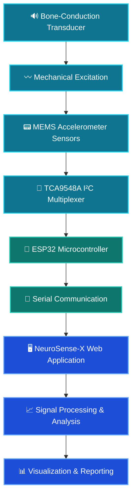

<div align="center">


<a href="https://git.io/typing-svg">
  
</a>

<br/>


<br/><br/>

**[About](#-about) · [Features](#-core-features) · [Architecture](#%EF%B8%8F-system-architecture) · [Hardware](#-hardware) · [Signal Processing](#-signal-processing--methods) · [Quick Start](#-quick-start) · [Serial Protocol](#-serial-protocol) · [Limitations](#%EF%B8%8F-experimental-limitations) · [Roadmap](#-roadmap)**

</div>

<br/>

## 🔬 About

**NeuroSense-X** is an experimental biomedical instrumentation and signal-analysis platform that **acquires, processes, analyses and visualizes mechanical vibration measurements across multiple cranial positions**.

It unites four layers in one workflow:

| | Layer | What it does |
|:-:|---|---|
| 🔌 | **Embedded** | ESP32 firmware talking to MEMS sensors over I²C |
| 📡 | **Acquisition** | Multi-sensor streaming through serial communication |
| 📈 | **Processing** | Digital signal processing and frequency-domain analysis |
| 🖥️ | **Visualization** | Interactive, real-time web dashboard and reporting |

<br/>

## ✨ Core Features

<table>
<tr>
<td width="50%" valign="top">

### 🔵 Hardware Connectivity
ESP32 integration, MEMS sensor communication and serial data acquisition.

</td>
<td width="50%" valign="top">

### 🟢 Live Monitoring
Real-time three-axis acceleration measurements and sensor visualization.

</td>
</tr>
<tr>
<td width="50%" valign="top">

### 🟣 Signal Processing
Baseline removal, filtering, RMS calculations and FFT analysis.

</td>
<td width="50%" valign="top">

### 🟠 Frequency Analysis
Frequency spectrum visualization and experimental resonance analysis.

</td>
</tr>
<tr>
<td width="50%" valign="top">

### 🔴 Sensor Comparison
Comparative acceleration analysis across multiple measurement positions.

</td>
<td width="50%" valign="top">

### ⚫ Reporting
Experimental data visualization, analysis summaries and reporting.

</td>
</tr>
</table>

<br/>

## ⚙️ System Architecture



<br/>

## 🔧 Hardware

| Component | Function |
|---|---|
| **ESP32-WROOM-32** | Microcontroller |
| **MPU6050** | Three-axis accelerometer and gyroscope |
| **TCA9548A** | I²C multiplexer |
| **Bone-Conduction Transducer** | Mechanical excitation |
| **PAM8403** | Audio amplification |

### 📍 Sensor Configuration

| Sensor | Measurement Position | Multiplexer Channel |
|:-:|---|:-:|
| **S1** | Left Temporal | `0` |
| **S2** | Right Temporal | `1` |
| **S3** | Frontal Midline | `2` |

<br/>

## 📊 Signal Processing & Methods

| Method | Application |
|---|---|
| **RMS** | Effective acceleration magnitude |
| **FFT** | Frequency-domain transformation |
| **Mean** | Average signal measurement |
| **Peak Amplitude** | Maximum signal magnitude |
| **Peak-to-Peak** | Total signal excursion |
| **Filtering** | Noise and unwanted frequency suppression |
| **Resonance** | Investigation of mechanical response peaks |
| **Damping** | Vibration decay characterization |
| **Attenuation** | Input-output amplitude comparison |
| **Transfer Function** | Frequency-dependent input-output relationship |
| **SNR** | Signal quality assessment |

<br/>

## 💻 Technology Stack

<div align="center">


</div>

<br/>

## 🚀 Quick Start

> **Prerequisites:** Node.js, npm and Git.

```bash
# 1 · Clone the repository
git clone https://github.com/Tonyteja369/NeuroSense-X-Software.git

# 2 · Enter the project
cd NeuroSense-X-Software

# 3 · Install dependencies
npm install

# 4 · Start the development server
npm run dev
```

> [!TIP]
> The Web Serial API is available in Chromium-based browsers such as Chrome and Edge.

<br/>

## 🔌 Serial Protocol

The ESP32 streams sensor measurements over serial communication.

| Setting | Value |
|---|---|
| **Baud Rate** | `115200` |
| **Format** | CSV, one sample per line |

```csv
timestamp_us,sensor_id,ax_g,ay_g,az_g
```

| Field | Description |
|---|---|
| `timestamp_us` | Timestamp in microseconds |
| `sensor_id` | Sensor identification |
| `ax_g` | X-axis acceleration (g) |
| `ay_g` | Y-axis acceleration (g) |
| `az_g` | Z-axis acceleration (g) |

<br/>

## ⚠️ Experimental Limitations

> [!IMPORTANT]
> The current prototype uses an **MPU6050-based acquisition architecture** with a **nominal 100 Hz sampling target**. At that rate the theoretical **Nyquist frequency is 50 Hz**.

> [!WARNING]
> High-frequency cranial vibration characterization requires higher-bandwidth sensors, faster synchronized acquisition, suitable calibration and controlled experimental conditions.

> [!NOTE]
> Resonance, damping, attenuation and transfer-function analysis require appropriate experimental measurements. Their inclusion in the software **does not imply** that these measurements have been experimentally validated.

> [!CAUTION]
> **Medical Disclaimer:** NeuroSense-X is an experimental biomedical engineering platform. It is **not** a clinically validated medical device and is **not** intended for medical diagnosis or treatment.

<br/>

## 🔭 Roadmap

- [ ] Higher-bandwidth vibration acquisition
- [ ] Synchronized multi-channel sensor measurements
- [ ] Calibrated mechanical excitation
- [ ] Advanced frequency-response characterization
- [ ] Experimental damping and attenuation analysis
- [ ] Improved signal-quality assessment
- [ ] Advanced research visualization and reporting

<br/>

<div align="center">


### NeuroSense-X
*An Experimental Biomedical Instrumentation Initiative*

</div>
